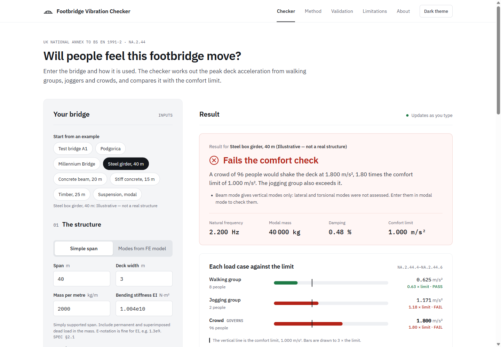

# Footbridge Vibration Checker

A free browser tool that checks whether people walking, jogging or crowding on a footbridge
will make it vibrate too much. It follows the UK National Annex to BS EN 1991-2, clause
NA.2.44, with the lateral and torsional triggers from DMRB CD 353.

**Use it here: <https://aidendarv.github.io/footbridge-vibration/>**



## What it does

You describe the bridge, either as a single simply supported span or as modes from an FE
model. The checker then:

- works out the peak vertical deck acceleration from walking groups and joggers (a moving
  pulsating force, NA.2.44.4) and from crowds (a steady-state distributed load, NA.2.44.5);
- compares each result with the vertical comfort limit from k1 to k4 (NA.2.44.6);
- checks lateral lock-in stability with the pedestrian mass damping parameter D (NA.2.44.7);
- flags frequencies that need a further check or provision for dampers;
- gives PASS, FAIL, INCOMPLETE or NOT REQUIRED in words, with response plots, a PDF calc
  sheet and a link that stores your inputs.

Everything runs in your browser. There is no backend, no account, no analytics and no
cookies.

## Who it is for

- Graduate and practising engineers doing a quick vibration serviceability check at concept
  or preliminary design stage, before (or instead of) building a full FE model.
- Checkers who want an independent hand check of an FE result.

## Vibration serviceability only

The tool checks vibration serviceability. It does **not** check strength, static deflection
or stability, which must be verified separately.

It is a screening and checking aid. It is not a substitute for a designer's judgement or a
full dynamic analysis. Verify results against NA+A1:2020 to BS EN 1991-2 and the project
requirements.

## Validation

Every check below runs in CI on each push, and the
[Validation page](https://aidendarv.github.io/footbridge-vibration/validation.html) shows
expected value, tool value and difference for each one.

- **Level 1 (analytical and code values) and Level 2 (numerical, with k and γ injected):**
  all checks within tolerance. Level 1 is exact to 4 significant figures; Level 2 is within
  0.5 % of an independent Python RK4 reference.
- **PD 6688-2 simplified method (§A.4):** the moving-load solver agrees with it to
  **+0.49 %** for a single walker and **−0.14 %** for a single jogger.
- **London Millennium Bridge, central span:** the lateral lock-in check gives D = 0.0319,
  below the stability boundary, so it predicts lock-in, as seen on opening day in June 2000.
  *Caveat:* this is a demonstration, not independent validation. The NA lateral method was
  developed partly from research on this bridge, so agreement is expected.
- **Podgorica footbridge, Montenegro (Živanović 2012):** walking-group predictions for
  classes B and C (0.614 and 0.743 m/s²) fall within the measured maximum instantaneous range
  of 0.59–0.80 m/s². Class D (0.949 m/s²) is above it, and all three are above the measured
  mean peak range, so the model is conservative here. This case is reported, not pass/fail.

The independent reference scripts are in [`validation/reference/`](validation/reference/)
(Python), and the benchmark inputs and expected results are in
[`validation/cases.json`](validation/cases.json).

## Standards used

- NA+A1:2020 to BS EN 1991-2 (UK National Annex), clause NA.2.44
- PD 6688-2:2011, Guidance for the design of structures to BS EN 1991-2 (typical damping
  values and background guidance)
- DMRB CD 353, Design criteria for footbridges (lateral and torsional frequency triggers)

### Digitised curves

The factors k(f), γ and the lateral stability boundary come from graphs in the National
Annex, not formulas. The data in [`src/data/`](src/data/) was digitised by the author from
Figures NA.8, NA.9 and NA.11 of NA+A1:2020 and checked by overlaying it on the source
figures. Each file records its source and estimated reading accuracy.

No text or figures from the standards are reproduced here. Only the numerical data needed to
run the method is included. **Users should hold a copy of the standard** and check the
method and results against it.

## Limitations

Not covered in this version:

- Lateral and torsional accelerations. NA+A1:2020 requires these for lateral and torsional
  modes below 2.5 Hz (limit 0.2 m/s²). The tool flags such modes, so the result is
  INCOMPLETE rather than PASS, but does not calculate them yet.
- Multi-span, continuous, cable-stayed and suspension bridges in beam mode (use modal mode
  with FE results instead).
- Closely spaced modes (NA.2.44.3 calls for more detailed analysis).
- Mass gatherings, deliberate synchronisation and vandal loading (excluded by NA.2.44.1).
- Human–structure interaction, and added pedestrian mass or damping.
- Wind, and any loading other than pedestrians.

Things the results depend on:

- Mode shapes must be scaled so their largest value is 1, and the modal mass must be for
  that scaling. A modal mass from FE software scaled to unit modal mass gives wrong answers.
- The digitised curves carry reading error. Outside Figure NA.8, k is taken as zero. γ is
  held at the edge of Figure NA.9 below its range with a warning, and above its range (damping
  over about 3.2 %) no result is given.
- A fundamental vertical frequency below 1 Hz never gives a PASS.

The full list is on the
[Limitations page](https://aidendarv.github.io/footbridge-vibration/limitations.html).

## Run it locally

You need [Node.js](https://nodejs.org/) 22.13 or later (or 24).

```sh
git clone https://github.com/AidenDarv/footbridge-vibration.git
cd footbridge-vibration
npm install
npm run dev        # local dev server
npm test           # run the test suite once
npm run lint       # ESLint and Prettier check
npm run build      # production build to dist/
npm run preview    # serve the production build
```

The site is served under `/footbridge-vibration/`, so open the path the dev server prints.

## Deployment

Each push to `main` runs the tests, lint and build in GitHub Actions. The site is deployed to
GitHub Pages only if all three pass.

## Licence

[MIT](LICENSE) © 2026 Aiden Darvell.

The MIT licence covers the code in this repository. It gives no rights in the British
Standards or other documents cited.
